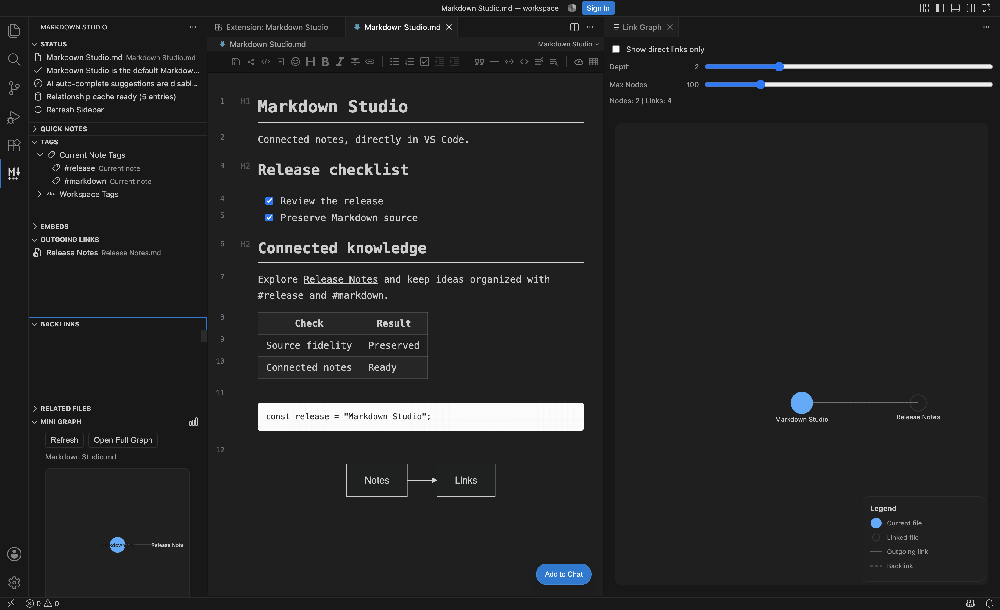
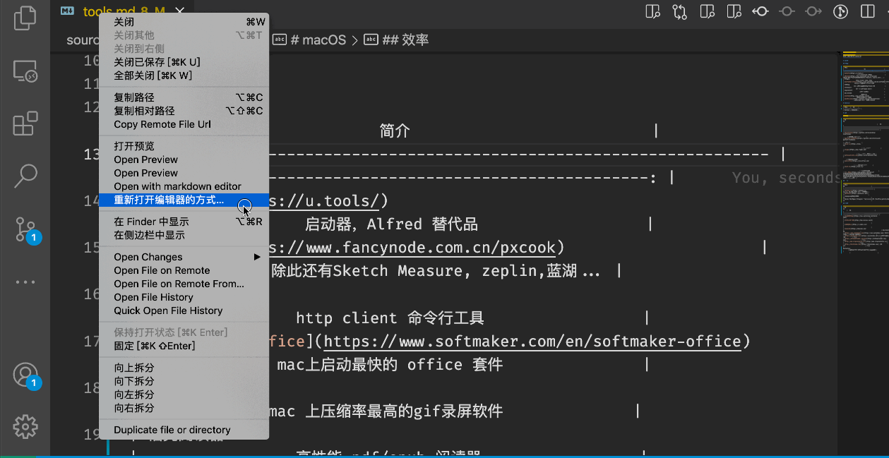

<p align="center"></p>

# Markdown Studio

Visual Markdown editing and connected notes for VS Code.

[](https://marketplace.visualstudio.com/items?itemName=phfsantos.markdown-editor)
[](https://marketplace.visualstudio.com/items?itemName=phfsantos.markdown-editor)
[](https://marketplace.visualstudio.com/items?itemName=phfsantos.markdown-editor)

Markdown Studio combines **WYSIWYG editing** with **Obsidian-style knowledge management**: wiki-links, an interactive graph view, backlinks, tag management, and Markdown tooling, all inside VS Code.

> **Formerly "Markdown Editor".** Only the display name changed. The extension ID (`phfsantos.markdown-editor`), commands, `markdown-editor.*` settings, and existing editor associations keep working without migration.

## 📸 Screenshots

### Obsidian-Style Knowledge Management



*Complete workspace view featuring: WYSIWYG editor (center), dedicated sidebar panel (left) with templates, tags, embeds, outgoing links, backlinks, related files, and interactive graph visualization (right) showing note connections and relationships.*

### WYSIWYG Editing Experience



*Real-time rendering, multiple editing modes, and seamless VS Code integration*

## ✨ Key Features

### WYSIWYG Editing

- **What You See Is What You Get** — Real-time rendering as you type
- **Multiple Editing Modes**: Instant Rendering (Recommended) / WYSIWYG / Split Screen
- **Auto-sync** between VS Code editor and webview
- **Multi-theme Support** — Adapts to your VS Code theme

### 🔗 Obsidian-Style Knowledge Management

- **Wiki-Link Support**: Use `[[filename]]` syntax with intelligent autocomplete and fuzzy matching
- **Dedicated Sidebar Panel** with real-time updates:
  - 📊 **Interactive Graph View** — Visualize note connections with adjustable depth and node limits
  - 🔍 **Quick Note Templates** — Daily notes, meeting notes, quick notes, and task lists
  - 🏷️ **Tag Management** — Browse workspace tags and filter files by tag
  - 📎 **Embed Previews** — Inline preview of images and embedded files
  - ↩️ **Backlinks** — See which notes link to the current file with context
  - 🔗 **Outgoing Links** — View all links in the current file with resolution status
  - 🎯 **Related Files** — Smart recommendations based on proximity, backlinks, and content similarity
- **Daily Notes**: Quick command to create/open today's note with customizable folder
- **Performance Optimized**: Incremental loading with caching for large workspaces

### 🛠️ Advanced Markdown Tools

- **Real-time Diagnostics**: Live validation and error detection with inline warnings
- **CodeLens**: Inline statistics for headings, images, and tables
- **Opt-In AI Auto-Complete**: Ghost-text suggestions stay off by default and can be enabled from settings or the Status sidebar panel
- **Powerful Commands**:
  - Show Heading Statistics
  - Add Alt Text to Images
  - Format Tables
  - Insert Table of Contents
  - Validate Document Structure
  - Open Full-Screen Graph View
  - Quick Open Note (Fuzzy Search)
  - Open Daily Note
  - Rebuild Relationship Cache
  - Filter Notes by Tag

### 📝 Rich Markdown Support

- **Image Handling**: Upload/paste/drag-drop with auto-save to configurable folder
- **Copy**: Export as markdown or HTML
- **Markdown Extensions** via [vditor](https://github.com/Vanessa219/vditor)
- **Rich Diagrams**: KaTeX, Mermaid, Graphviz, ECharts, abc.js (music notation)
- **Custom CSS**: Personalize layout and styling

### ⚡ Performance & Caching

- **Smart Optimization**: Auto-detects workspace size and optimizes accordingly
- **Intelligent Caching**: 10-minute cache with automatic invalidation on file changes
- **Cache Management**: Visual cache status in sidebar with one-click rebuild
- **Incremental Loading**: Sidebar sections load progressively for instant feedback
- **Configurable Performance Modes**: Auto / Performance / Compatibility
- **Parallel Processing**: Backlinks, outgoing links, and related files computed simultaneously

## Install

[https://marketplace.visualstudio.com/items?itemName=phfsantos.markdown-editor](https://marketplace.visualstudio.com/items?itemName=phfsantos.markdown-editor)

## Supported syntax

[demo article](https://ld246.com/guide/markdown)

## Usage

### 1. Command mode in markdown file

- open a markdown file
- type `cmd-shift-p` to enter command mode
- type `Markdown Studio: Open in Markdown Studio`

### 2. Key bindings

- open a markdown file
- type `ctrl+shift+alt+m` for win or `cmd+shift+alt+m` for mac

### 3. Explorer Context menu

- right click on markdown file
- then click `Open in Markdown Studio`

### 4. Editor title context menu

- right click on an open markdown file's tab title
- then click `Open in Markdown Studio`

### 5. Open at a source position

Links between Markdown files can target a source line or a source line and character:

```markdown
[Open line 12](./notes/example.md#L12)
[Open line 12, character 5](./notes/example.md#L12C5)
```

External tools can use the extension-owned URI handler. Pass the target file as an encoded URI; `character` is optional and defaults to 1:

```text
vscode://phfsantos.markdown-editor/open?uri=file%3A%2F%2F%2Fworkspace%2Fnotes%2Fexample.md&line=12&character=5
```

Line and character values in links are positive and one-based. Internally, character positions use VS Code's zero-based UTF-16 offsets, so Unicode positions follow VS Code's standard cursor semantics. Targets must be existing `.md` or `.markdown` files.

VS Code's generic `--goto file:line:character` option does not select a custom editor and may open the built-in text editor. Use the `vscode://phfsantos.markdown-editor/open` URI when Markdown Studio must open at the requested position.

### 6. Make Markdown Studio the default editor

Run `Markdown Studio: Set Markdown Studio as Default` (or use the Status view in the sidebar). It adds `*.md` and `*.markdown` to your user-level `workbench.editorAssociations` and keeps every other association you already have. Workspace settings are never copied into user settings. To cover more extensions, add patterns such as `"*.mdown": "markdown-editor"` yourself.

### Custom CSS (custom layout and vditor personalization)

Add CSS rules as a single string in your settings.json:

```json
{
  "markdown-editor.customCss": ".vditor-reset { max-width: 900px; margin: 0 auto; }"
}
```

## ⚙️ Configuration

The extension provides many settings to customize your experience:

### Editor Settings

```json
{
  // Image save folder (relative to markdown file or use ${projectRoot}/assets for workspace root)
  "markdown-editor.imageSaveFolder": "assets",
  
  // Use VS Code theme colors in the editor
  "markdown-editor.useVscodeThemeColor": true,
  
  // Custom CSS rules for editor styling
  "markdown-editor.customCss": ""
}
```

### Feature Toggles

```json
{
  // Enable real-time diagnostics and error detection
  "markdown-editor.enableDiagnostics": true,
  
  // Show CodeLens for headings, images, and tables
  "markdown-editor.enableCodeLens": true,
  
  // Apply visual decorations to markdown elements
  "markdown-editor.enableDecorations": true,
  
  // Enable #tag support in sidebar
  "markdown-editor.enableTagSupport": true,
  
  // Enable debug logging (useful for troubleshooting)
  "markdown-editor.enableDebugLogging": false
}
```

### Widget Commands

Button, Macro Board, and Dev Commands widgets can run VS Code commands. Because widget
config comes from the Markdown document, widget commands never run in untrusted
workspaces, and any command that is not in `markdown-editor.widgets.allowedCommands`
(or that passes arguments) asks for confirmation first. The allowlist is a user-level
setting, so a repository cannot extend it.

```json
{
  "markdown-editor.widgets.allowedCommands": [
    "workbench.action.openSettings",
    "workbench.action.showCommands"
  ]
}
```

### AI Settings

```json
{
  // Enable AI workflows for .agent.md, .prompt.md, and SKILL.md files
  "markdown-editor.ai.enable": true,

  // Opt in to AI auto-complete suggestions in both editors
  "markdown-editor.ai.enableInlineSuggestions": false,

  // Show AI badges and actions inside the custom editor
  "markdown-editor.ai.enableAffordances": true,

  // Allow AI workflows to hand context off to chat surfaces
  "markdown-editor.ai.enableChatInterop": true
}
```

You can also toggle `markdown-editor.ai.enableInlineSuggestions` from the Status view in the Markdown Studio sidebar. The status panel includes a one-click entry and title-bar button so the feature can stay opt-in without digging through settings.

### Performance Settings

```json
{
  // Performance mode: "auto", "performance", or "compatibility"
  "markdown-editor.performanceMode": "auto"
}
```

### Knowledge Management & Performance

```json
{
  // Folder for daily notes (relative to workspace root)
  "markdown-editor.dailyNotesFolder": "daily",
  
  // Enable #tag support and parsing
  "markdown-editor.enableTagSupport": true,
  
  // Maximum file sizes for embed previews
  "markdown-editor.previewEmbedSizeLimit": 5242880,      // 5 MB (generic files)
  "markdown-editor.previewEmbedImageLimit": 8388608,     // 8 MB (images)
  "markdown-editor.previewEmbedTextLimit": 204800        // 200 KB (text files)
}
```

### Commands

Access these commands via Command Palette (`Ctrl+Shift+P` or `Cmd+Shift+P`):

- `Markdown Studio: Open in Markdown Studio` - Open file in WYSIWYG editor
- `Markdown Studio: Set Markdown Studio as Default` - Make this the default for `.md` and `.markdown` files
- `Markdown Studio: Open Link Graph View` - Open full-screen interactive graph
- `Markdown Studio: Quick Open Note (Fuzzy)` - Fuzzy search all markdown files
- `Markdown Studio: Open Daily Note` - Create/open today's daily note
- `Markdown Studio: Rebuild Relationship Cache` - Manually rebuild link/tag cache
- `Markdown Studio: AI: Toggle Auto-Complete Suggestions` - Enable or disable opt-in AI ghost text
- `Markdown Studio: Show Heading Statistics` - Analyze document structure
- `Markdown Studio: Validate Document Structure` - Check for markdown issues
- `Markdown Studio: Format Table` - Auto-format markdown table
- `Markdown Studio: Insert Table of Contents` - Generate TOC from headings

## 🔧 Troubleshooting

### Enable Debug Logging

If you encounter issues, enable debug logging to see detailed information:

1. Open Settings (JSON): `Ctrl+Shift+P` → "Preferences: Open Settings (JSON)"
2. Add: `"markdown-editor.enableDebugLogging": true`
3. Open the Output panel: View → Output
4. Select "Markdown Studio" from the dropdown
5. Reproduce the issue and check the logs

### Performance with Large Workspaces

For workspaces with many markdown files (500+):

1. Set performance mode to "performance": `"markdown-editor.performanceMode": "performance"`
2. Consider disabling features you don't use:

  ```json
   {
     "markdown-editor.enableDiagnostics": false,
     "markdown-editor.enableCodeLens": false
   }
   ```

### Wiki-Links Not Working

Ensure you're using the correct syntax:

- `[[filename]]` — Links to filename.md
- `[[folder/filename]]` — Links to file in subfolder
- File extensions are optional

## ⚠️ Known Issues

- **The editor-type dropdown shows "Markdown Studio - Markdown Studio".** VS Code's picker always shows "editor name - extension name" for extension editors, and an extension can't change that format. Markdown Studio uses the same name for both, so it appears twice (Hex Editor and Excalidraw do the same). This is cosmetic and choosing the entry works normally. Showing the name only once needs a change in VS Code. Giving the editor a different name, such as "Visual Editor - Markdown Studio", would also avoid the repeat, but we kept one name for consistency.

## 📚 Supported Syntax

For complete markdown syntax guide, see: [demo article](https://ld246.com/guide/markdown)

Maintainers working on fenced custom renderers should also read the
[custom-block save integrity contract](./docs/custom-block-save-integrity.md).

## 📰 Release Notes

See [CHANGELOG.md](./CHANGELOG.md) for release notes.

## 🙏 Acknowledgement

- [vscode](https://github.com/microsoft/vscode)
- [vditor](https://github.com/Vanessa219/vditor)
- [phfsantos](https://github.com/phfsantos)

## 📝 Todo

- [ ]  Code splitting for main.js bundle size optimization
- [ ]  Multi-root workspace support

## License

MIT

## Support

If you like this extension make sure to star the repo. I am always looking for new ideas and feedback. In addition, it is possible to [donate via paypal](https://www.paypal.me/phfsantos).
