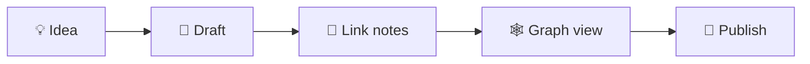

# Markdown Studio Showcase

Write Markdown visually, link your notes, and see how ideas connect, without leaving VS Code. #markdown-studio #showcase

> **Tip:** open the Markdown Studio sidebar to see this note's backlinks, outgoing links, tags, and graph update as you type.

## Connected notes

This note links to [[Getting Started]], the [[Wiki Links Guide]], and [[Tags and Organization]]. It also feeds a project: [[projects/Personal Knowledge Base]], with supporting material in [[projects/Research Notes]].

Tags such as #release #ideas and #todo appear in the sidebar's Tags view.

## Launch checklist

- [x] Draft the release notes
- [x] Link the research notes
- [ ] Record the demo video
- [ ] Publish to the Marketplace

## Release plan

| Milestone | Owner | Status |
| :-------- | :---- | :----: |
| Branding  | Design | ✅ Done |
| Docs      | Writing | ✅ Done |
| Launch    | Team | 🚧 In progress |



## Focus widgets

```widget
type: habit-tracker
title: Write every day
size: md
---
data: {"completedDates": ["2026-10-19", "2026-10-20", "2026-10-21", "2026-10-22", "2026-10-23", "2026-10-26", "2026-10-27", "2026-10-28", "2026-10-29", "2026-10-30"]}
```

```widget
type: timer
title: Focus session
size: md
initialMinutes: 25
```

## Math and code

The weight of a link between two notes, where $d$ is the distance between them:

$$
w(a, b) = \frac{\text{shared tags}(a, b) + 1}{d(a, b)}
$$

```typescript
export function backlinksFor(note: string, notes: Map<string, string[]>): string[] {
  return [...notes].filter(([, links]) => links.includes(note)).map(([name]) => name);
}
```
